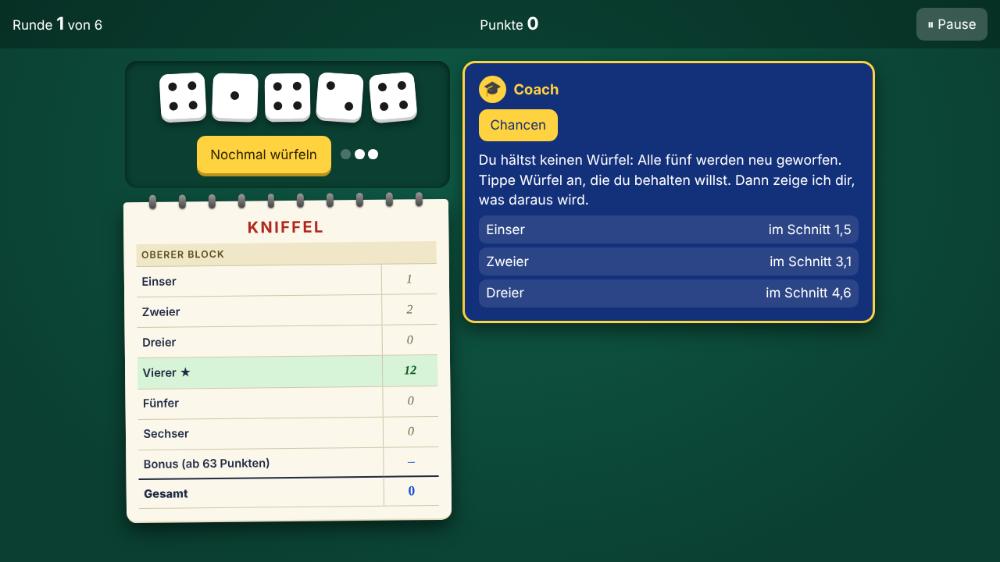

# How the Yahtzee Trainer works

The pictures on this page are screenshots from the app’s automatic tests (`e2e/anleitung.e2e.ts`). This is what the app really looks like. When the look changes, the tests run again and replace the pictures.

[Deutsch](anleitung.md)

## 1. Choose the game

You open the mode you want: explain mode, game with joker or plain game. Then you choose the upper half (6 rounds) or the whole sheet (13 rounds).

## 2. The coach goes along with you

In explain mode you throw the dice and decide yourself which to keep. The coach does not tell you what to do. It works with the dice you keep: three chances as a ring with percent and as a fraction, and an overview of how often which points come out if you play the position 100 times. The average of these 100 tries is the “on average”. As long as you keep nothing, the coach says so and waits.

## 3. How it works: the tree

Under “How it works” you see how the chance comes about. Each branch shows its chance, the end of each way the product. The green ways have at least one 4. You add them up or take the opposite.

## 4. With two throws

In the second step you work out two throws: first no 4 twice in a row, then the opposite.

## 5. The joker: empty tree

In the game with joker you play yourself. When you are stuck, ask the joker. On level 1 the tree is empty: you enter how likely each branch is.

## 6. Entered correctly

When your fraction is right, the branch is shown in the tree.

## 7. Level 2: the ways

On level 2 the branches are filled in. You work out one way (times) and add up the green ways.

## 8. Level 3: the solution

On level 3 you see the solution and the tip which dice you could keep and which field they aim for, with bars of how often which points come out. It is your choice; the joker is only a help.

## 9. Feedback after the move

When you enter a field, the trainer tells you how the move was and what would have been better.

## 10. The plain game

In the plain game there is no help. You collect points for the high-score list.

## 11. The end

At the end you see your points and the high-score list. It stays on your device and has no names.

## On a phone

At 360 pixels wide the view looks like this:

