# So funktioniert der Kniffel-Trainer

Die Bilder dieser Seite sind Bildschirmfotos aus den automatischen Tests der App (`e2e/anleitung.e2e.ts`). So sieht die App wirklich aus. Wenn sich das Aussehen ändert, laufen die Tests erneut und die Bilder werden ersetzt.

[English](anleitung.en.md)

## 1. Spiel wählen

Du öffnest den Modus, den du spielen willst: Erklärmodus, Spiel mit Joker oder Reines Spiel. Dann wählst du, ob du die obere Hälfte (6 Runden) oder das ganze Blatt (13 Runden) spielst.

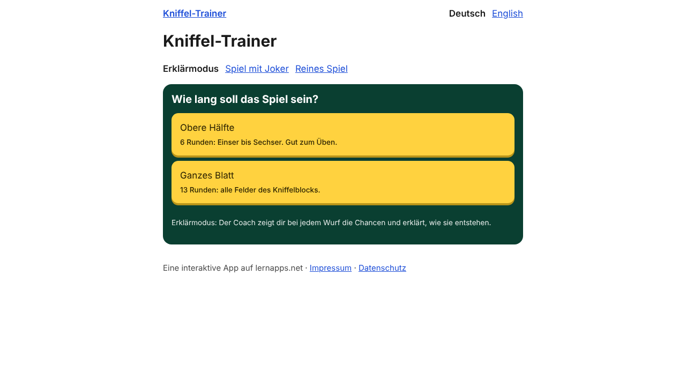

## 2. Der Coach zeigt die Chancen

Im Erklärmodus würfelst du. Der Coach sagt dir, welche Würfel du behalten solltest (gestrichelt umrandet), und zeigt drei Chancen als Ring mit Prozent und als Bruch.

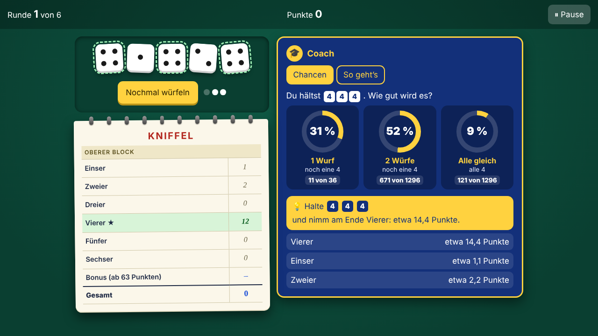

## 3. So geht’s: der Baum

Unter „So geht’s“ siehst du, wie die Chance entsteht. An jedem Ast steht die Chance, am Ende jedes Weges das Produkt. Die grünen Wege haben mindestens eine 4. Man kann sie zusammenzählen oder das Gegenteil nehmen.

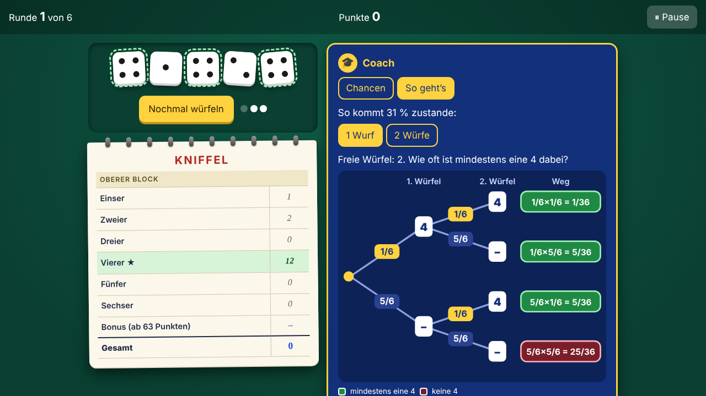

## 4. Mit zwei Würfen

Im zweiten Schritt rechnest du, wie es mit zwei Würfen aussieht: erst zweimal keine 4, dann das Gegenteil.

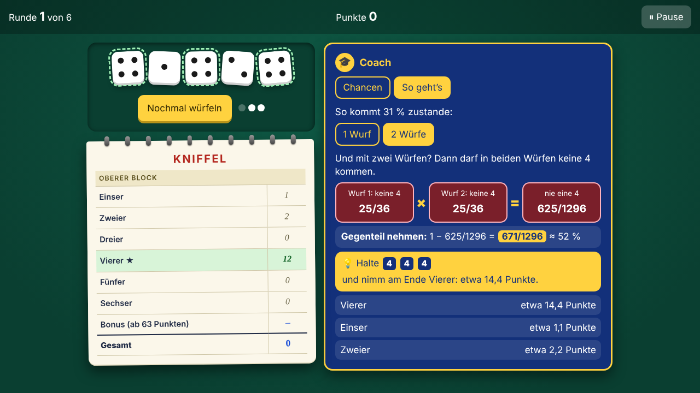

## 5. Der Joker: Baum leer

Im Spiel mit Joker spielst du selbst. Wenn du nicht weiterweißt, fragst du den Joker. Auf Stufe 1 ist der Baum leer: Du trägst ein, wie wahrscheinlich jeder Ast ist.

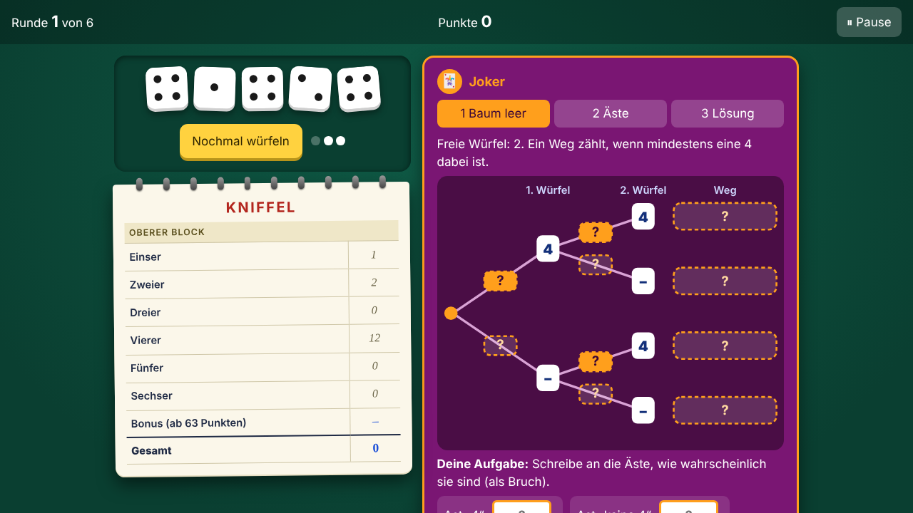

## 6. Richtig eingetragen

Stimmt dein Bruch, wird der Ast im Baum aufgedeckt.

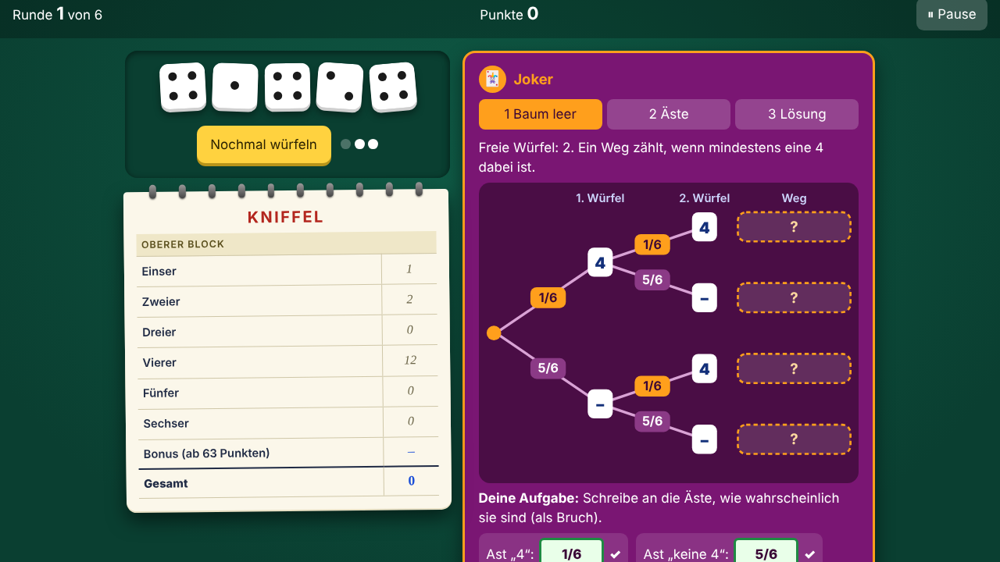

## 7. Stufe 2: die Wege

Auf Stufe 2 stehen die Äste. Du rechnest einen Weg aus (mal) und zählst die grünen Wege zusammen.

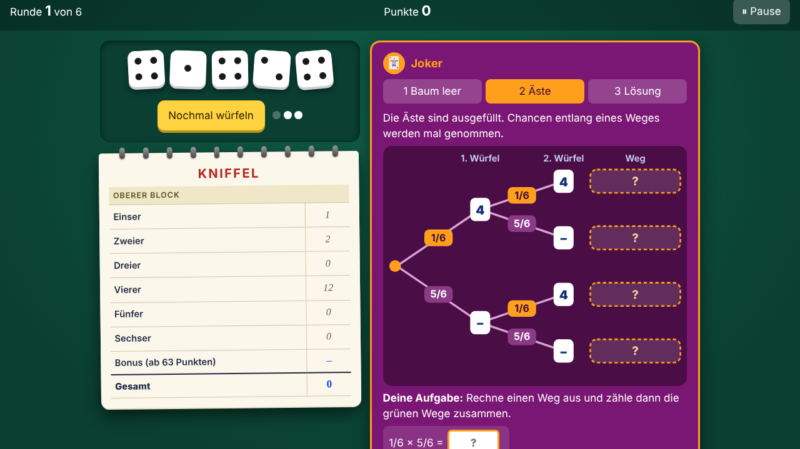

## 8. Stufe 3: die Lösung

Auf Stufe 3 siehst du die Lösung und den Tipp, welche Würfel du behalten und welches Feld du nehmen solltest.

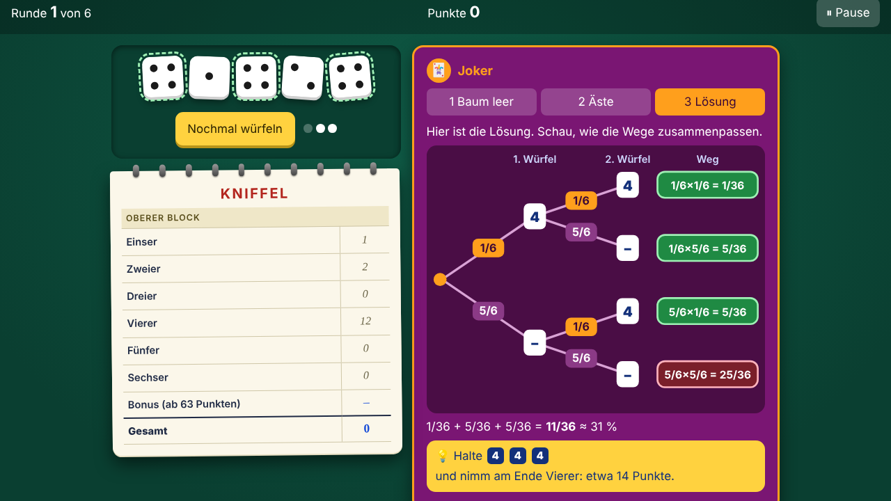

## 9. Rückmeldung nach dem Zug

Wenn du ein Feld einträgst, sagt dir der Trainer, wie der Zug war und was besser gewesen wäre.

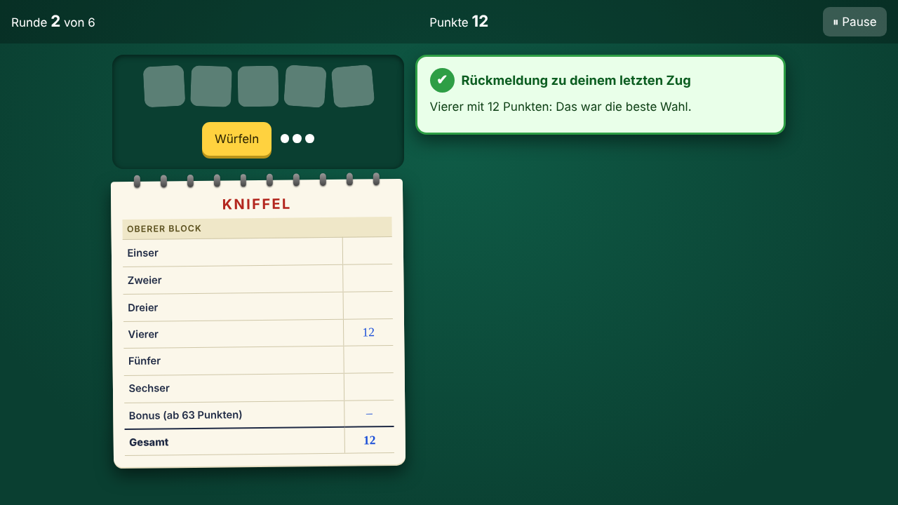

## 10. Das reine Spiel

Beim reinen Spielen gibt es keine Hilfe. Du sammelst Punkte für die Bestenliste.

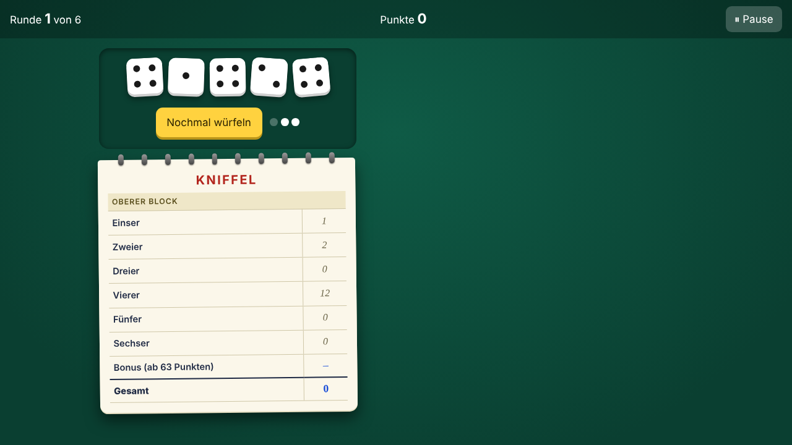

## 11. Das Ende

Am Ende siehst du deine Punkte und die Bestenliste. Sie bleibt auf deinem Gerät und enthält keine Namen.

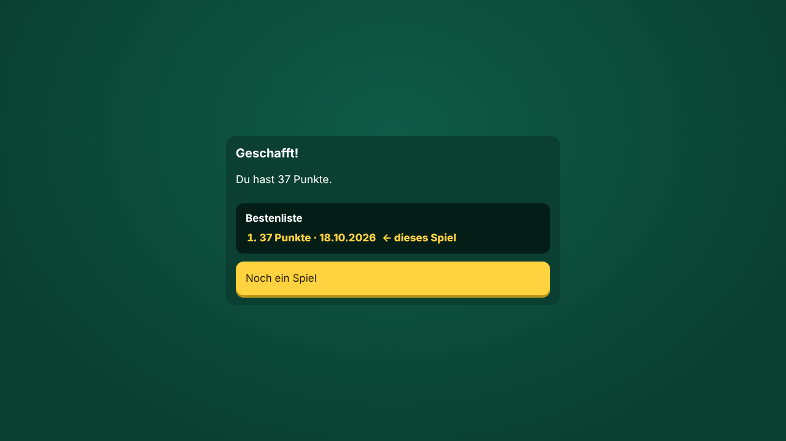

## Auf dem Handy

Bei 360 Pixel Breite sieht die Ansicht so aus:

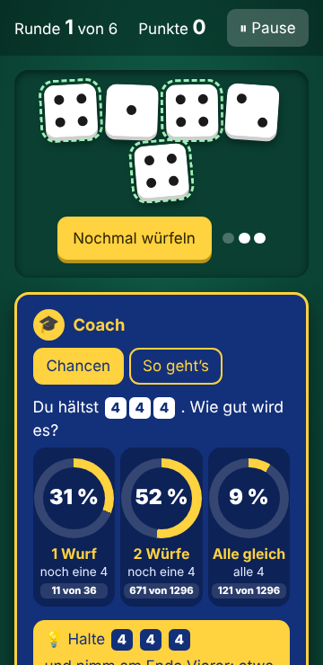

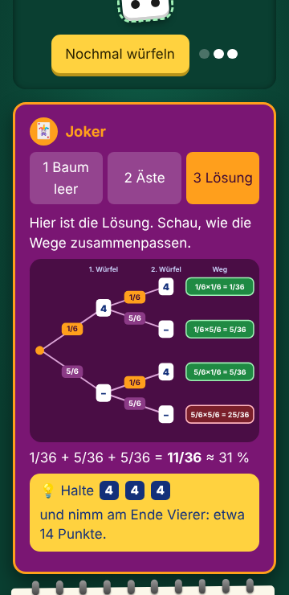

