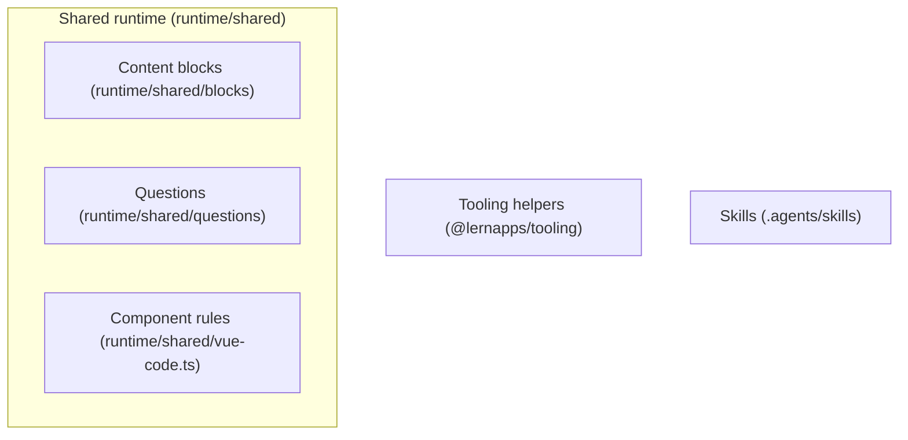
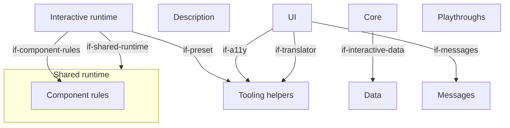
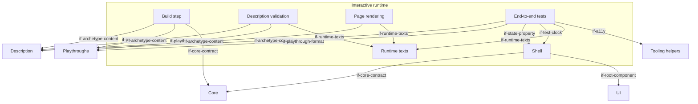
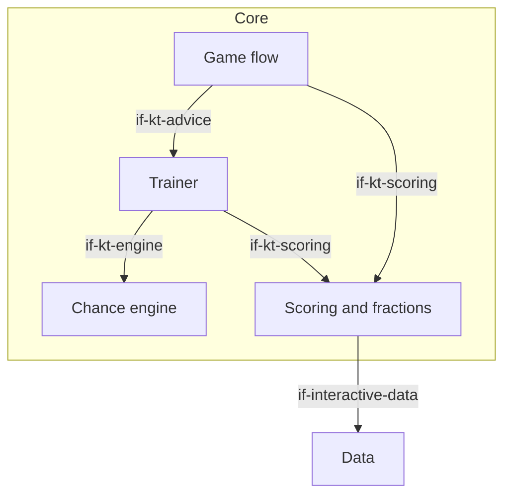
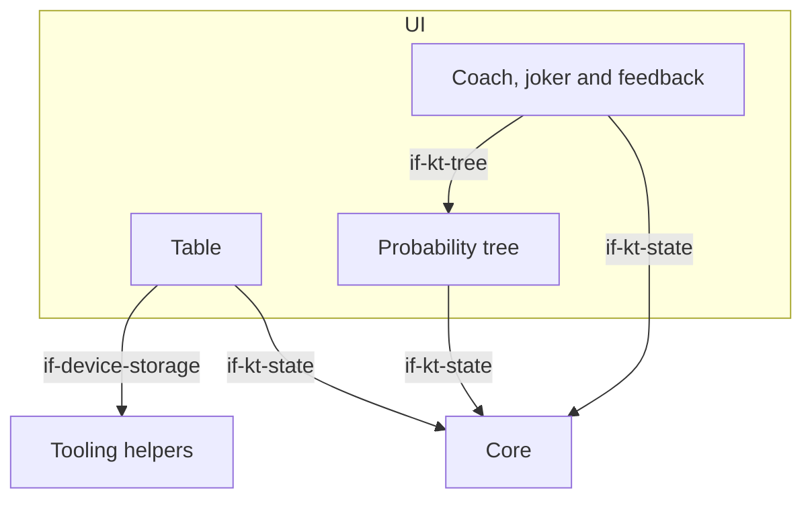

# Building Blocks

<!-- From @lernapps/app-templates 0.27.0 (the generic part and the interactive extension): lernapps update replaces this file except the app sections, between <!-- app: begin … --> and <!-- app: end … -->, which hold the app's own architecture. -->

The generic part has three roots that every app shares: the shared runtime of `@lernapps/app-templates`, the tooling
helpers of `@lernapps/tooling` and the skills the app commits.

Each archetype's extension adds the rest of level 1. It defines the runtime `bb-archetype-runtime` with the parts
`bb-build`, `bb-validation`, `bb-render`, `bb-shell`, `bb-e2e` and `bb-runtime-texts`, under exactly these ids. It
also defines the parts the creator writes; one of them provides `if-archetype-content`. Parts that only some
archetypes have are in their extensions. A loading indicator (`dec-no-size-limit`) and a settings dialog
(`dec-no-settings`) are not part of the frame.

Paths are relative to the root of `lernapps/app-templates`. In an app's copy, a template folder's paths lose the
folder prefix. An app's architecture is this part followed by its extension, so the level-1 view of a whole app is in
its extension.

## Level 1: the generic roots

```arc42
:::diagram
id: building-blocks-generic
view: building-block
notation: mermaid
:::
```



## Shared runtime

Built. The code the archetypes' runtimes share. It provides:

- the page trees in every declared language, with the language switch and the 404 page;
- learner texts by language;
- reading content from YAML and reporting its problems by file and line;
- restricted Markdown and formulas;
- the frame of every page, with header, footer, and light and dark colours;
- the examples check, which runs an exercise's examples through the same checker as the page;
- Vue at build, for archetypes with components;
- the content blocks, the questions and the component rules (below).

The app never edits it.

```arc42
:::ignore H014 installed package @lernapps/app-templates (arc42 cannot resolve untracked paths, docToolchain/arc42-language#128)
:::
:::building-block
id: bb-runtime
title: Shared runtime
technology: TypeScript
implements: concept-languages, concept-readable-without-js
:::
```

### Shared runtime modules

The archetype's runtime uses them at build and in its tests.

```arc42
:::ignore H014 installed package @lernapps/app-templates (arc42 cannot resolve untracked paths, docToolchain/arc42-language#128)
:::
:::interface
id: if-shared-runtime
title: Page trees, languages, examples check, Vue at build
provider: bb-runtime
protocol: TypeScript imports (runtime/shared)
:::
```

### Content blocks

Built, for every archetype that shows content. The blocks are prose, a formula, a figure, a labelled figure, a table,
a quotation and program code, with the credit of an image or quotation. Images come from the app's `src/images/`.
This block owns their schema, their checks, their rendering and their look. The quiz shows them as material of a
question, the explainer as blocks of a page.

```arc42
:::ignore H014 installed package @lernapps/app-templates (arc42 cannot resolve untracked paths, docToolchain/arc42-language#128)
:::
:::building-block
id: bb-blocks
title: Content blocks
parent: bb-runtime
technology: TypeScript
:::
```

#### Content blocks interface

Validation and rendering of an archetype use their types, checks and renderer.

```arc42
:::ignore H014 installed package @lernapps/app-templates (arc42 cannot resolve untracked paths, docToolchain/arc42-language#128)
:::
:::interface
id: if-blocks
title: The content blocks (checkMaterial, renderMaterial, materialIn)
provider: bb-blocks
protocol: TypeScript imports (runtime/shared/blocks), @lernapps/app-templates/blocks
:::
```

### Questions

Built, for every archetype that has questions. It holds the six question types and decides what counts as a right
answer. The same decision holds at build, in the browser and in the tests. The quiz asks the questions; the explainer
uses them in its exercises. Neither archetype imports the other.

```arc42
:::ignore H014 installed package @lernapps/app-templates (arc42 cannot resolve untracked paths, docToolchain/arc42-language#128)
:::
:::building-block
id: bb-questions
title: Questions
parent: bb-runtime
technology: TypeScript
:::
```

#### Questions interface

Validation, rendering, browser code and tests of an archetype use the question types and their checker.

```arc42
:::ignore H014 installed package @lernapps/app-templates (arc42 cannot resolve untracked paths, docToolchain/arc42-language#128)
:::
:::interface
id: if-questions
title: The question types, rendering, engine and checker
provider: bb-questions
protocol: TypeScript imports (runtime/shared/questions), @lernapps/app-templates/questions
:::
```

### Component rules

Built, for every archetype that has Vue components. It checks a component and the app's modules it imports against
the concept "Component rules" (chapter 8). Each archetype sets which modules count as the app's own.

```arc42
:::ignore H014 installed package @lernapps/app-templates (arc42 cannot resolve untracked paths, docToolchain/arc42-language#128)
:::
:::building-block
id: bb-component-rules
title: Component rules
parent: bb-runtime
technology: TypeScript, Vue SFC compiler
implements: concept-component-rules
:::
```

#### Component rules interface

An archetype's validation runs these checks on its components.

```arc42
:::ignore H014 installed package @lernapps/app-templates (arc42 cannot resolve untracked paths, docToolchain/arc42-language#128)
:::
:::interface
id: if-component-rules
title: The code checks of a component (codeProblems, with the archetype's scope)
provider: bb-component-rules
protocol: TypeScript imports (runtime/shared/vue-code.ts)
:::
```

## Tooling helpers

Built. The parts of `@lernapps/tooling` that every app uses. Rules, helpers and guidance reach the app through
updates, without edits. The block provides:

- the build preset: lint with the lernapps rules, type check, format, unit tests and git hooks;
- lint rules for the platform's rules;
- `lernapps check`, which tests the built app;
- the test browser setup at desktop width and 360 px;
- small device storage, accessibility helpers and translation.

The skills are a block of their own. Large storage (IndexedDB) is left out (`dec-small-storage`).

```arc42
:::ignore H014 @lernapps/tooling is installed in node_modules (node_modules/@lernapps/tooling), which git does not track, and the validator resolves paths only among tracked files (E011)
:::
:::building-block
id: bb-tooling
title: Tooling helpers
technology: TypeScript, vite-plus, Playwright (@lernapps/tooling, an optional peer of this package)
implements: concept-accessibility, concept-component-rules, concept-device-storage, concept-languages, concept-readable-without-js
:::
```

### Preset interface

The app's build configuration uses the preset with its archetype's plugin.

```arc42
:::ignore H014 the interface is in @lernapps/tooling, installed in the untracked node_modules (archetypes/shared/preset.ts)
:::
:::interface
id: if-preset
title: lernapps() preset
provider: bb-tooling
protocol: TypeScript import, @lernapps/tooling/preset
:::
```

### Check command

The creator's assistant, the pre-push hook and CI run `lernapps check`. Its report names each rule that failed.

```arc42
:::ignore H014 the interface is in @lernapps/tooling, installed in the untracked node_modules (check/)
:::
:::interface
id: if-lernapps-check
title: lernapps check command
provider: bb-tooling
protocol: CLI, validation report
:::
```

### Device storage interface

Loads, saves and removes values under the app's prefix. The app keeps working when storage is blocked or full.

```arc42
:::ignore H014 the interface is in @lernapps/tooling, installed in the untracked node_modules (archetypes/shared/storage.ts)
:::
:::interface
id: if-device-storage
title: createStorage(app)
provider: bb-tooling
protocol: TypeScript import, @lernapps/tooling/storage
:::
```

### Accessibility helpers interface

Announces changes to screen readers, moves the focus and tells whether the learner wants less motion.

```arc42
:::ignore H014 the interface is in @lernapps/tooling, installed in the untracked node_modules (archetypes/shared/a11y.ts)
:::
:::interface
id: if-a11y
title: announce, moveFocus, prefersReducedMotion
provider: bb-tooling
protocol: TypeScript import, @lernapps/tooling/a11y
:::
```

### Translator interface

Code gets learner texts from the translator, never as strings in code.

```arc42
:::ignore H014 the interface is in @lernapps/tooling, installed in the untracked node_modules (archetypes/shared/i18n.ts)
:::
:::interface
id: if-translator
title: translator(messages)
provider: bb-tooling
protocol: TypeScript import, @lernapps/tooling/i18n
:::
```

## Skills

Built in the tooling. An app commits its skills under `.agents/skills/`: one for every app, one for its archetype,
some for content and listing, and the app's own content guide. `lernapps update` replaces the platform's skills and
leaves the app's own alone. The skills hold the guidance that no check can give (`dec-skill-interface`).

```arc42
:::ignore H014 the skills are committed in each app under .agents/skills; this repository has none
:::
:::building-block
id: bb-skills
title: Skills
technology: Markdown skills (SKILL.md), from the skills/ folder of @lernapps/tooling
implements: concept-low-stimulation
:::
```

### Skills interface

The creator's assistant loads the skills before it works on the app.

```arc42
:::ignore H014 the skills are committed in each app under .agents/skills; this repository has none
:::
:::interface
id: if-skills
title: Skill texts (lernapps-app, the archetype's skill, the content skills, app-content)
provider: bb-skills
protocol: Markdown (SKILL.md) loaded by the assistant
:::
```


The interactive archetype's extension of the generic architecture (`docs/arc42/` at the root of
`lernapps/app-templates`). In an interactive app, doing is the content.
It has a static start page and one app page. On the app page the shell runs the app's deterministic core and shows its
state with the app's Vue components. Hash routes select modes and levels.

The runtime ships the build step, the pages, the shell and the end-to-end tests.
The creator writes the description, the core, the UI, the data, the messages and the playthroughs, and `src/main.ts`.
The archetype reuses the explainer's component rules. It has no tutor handoff, task numbers, exercise contract or
examples check; its playthroughs take the examples' role. Only the start page reads without JavaScript.

An app gets this architecture as a copy and adds its own blocks below the core, the UI and the data.
It writes its part between the markers `<!-- app: begin … -->` and `<!-- app: end … -->`.
The tooling keeps that part when it replaces the rest.
The creator's assistant follows the skill `lernapps-interactive` (`if-skills`).

## Level 1 (interactive app)

```arc42
:::diagram
id: building-blocks-interactive-level-1
view: building-block
notation: mermaid
:::
```



## Level 2: the interactive runtime

```arc42
:::diagram
id: building-blocks-interactive-runtime
view: building-block
notation: mermaid
:::
```



## Interactive runtime

Built. The runtime of every interactive app; the app does not change it.
It builds and checks the app, starts its core and UI in the browser and brings the end-to-end tests.

```arc42
:::ignore H014 installed package @lernapps/app-templates (arc42 cannot resolve untracked paths, docToolchain/arc42-language#128)
:::
:::building-block
id: bb-archetype-runtime
title: Interactive runtime
technology: TypeScript, Vite plugin, Vue
requires: if-shared-runtime, if-preset, if-component-rules
implements: concept-archetype-extension
:::
```

### Build step

Built. Reads the description and the playthroughs and runs the component rules on the UI.
It checks that the core has the contract's exports and that every route starts.
It plays every playthrough against the core twice. The build fails when the two plays differ or a state differs from
the expected one. Only then does it write the start page, the app page and the 404 page.
No time passes in a play except the ticks a step names. An app's code has no size limit (`dec-no-size-limit`).

```arc42
:::ignore H014 installed package @lernapps/app-templates (arc42 cannot resolve untracked paths, docToolchain/arc42-language#128)
:::
:::building-block
id: bb-build
title: Build step
parent: bb-archetype-runtime
technology: Vite plugin
requires: if-archetype-content, if-playthrough-format, if-core-contract, if-component-rules
implements: concept-playthroughs, concept-determinism
:::
```

#### Build plugin interface

The app's Vite configuration adds the plugin to the tooling preset. That is the only way the app enters the build.

```arc42
:::ignore H014 installed package @lernapps/app-templates (arc42 cannot resolve untracked paths, docToolchain/arc42-language#128)
:::
:::interface
id: if-build-plugin
title: interactive() Vite plugin
provider: bb-build
protocol: TypeScript import, @lernapps/app-templates/interactive/plugin
:::
```

### Description validation

Built. Checks the description and every playthrough against their schemas and what a schema cannot say, such as
complete languages, unique ids and known routes. It reports one line per problem with file and line.

```arc42
:::ignore H014 installed package @lernapps/app-templates (arc42 cannot resolve untracked paths, docToolchain/arc42-language#128)
:::
:::building-block
id: bb-validation
title: Description validation
parent: bb-archetype-runtime
technology: Ajv, JSON Schema, YAML
requires: if-archetype-content, if-playthrough-format, if-runtime-texts
:::
```

### Page rendering

Built. Renders two pages in each language.
The start page says what the app does, how to play and what it trains, and links into the app and its routes.
It needs no script. The app page holds the title, the route links and the place where the app runs.
Without JavaScript it shows a note and a link back.

```arc42
:::ignore H014 installed package @lernapps/app-templates (arc42 cannot resolve untracked paths, docToolchain/arc42-language#128)
:::
:::building-block
id: bb-render
title: Page rendering
parent: bb-archetype-runtime
technology: TypeScript, HTML
requires: if-archetype-content, if-runtime-texts
implements: concept-readable-without-js, concept-hash-routes, concept-accessibility
:::
```

#### Pages interface

Learners, teachers and parents read the start page at `lernapps.net/<repo>/` and play at `app/?seed=<n>#<route>`.
The catalog entry's topics link to the routes. Another app can link with more parameters in the address.
The core gets them as data (`dec-address-params`).

```arc42
:::ignore H014 installed package @lernapps/app-templates (arc42 cannot resolve untracked paths, docToolchain/arc42-language#128)
:::
:::interface
id: if-pages
title: Start page and app page app/?seed=<n>#<route>
provider: bb-render
protocol: HTML pages over HTTPS (query and hash)
:::
```

### Shell

Built. Mounts the app's root component on the app page and holds the core's state.
It starts the core with the seed, the route and the other parameters of the address; without a seed it draws one.
A new route starts the core again with the same seed and parameters.
It passes the learner's inputs to the core (`dec-typed-input`) and lets time pass when the core moves on its own.
The language switch opens the same round in the other language (`dec-address-params`).

The page header holds only the language switch; an app with one language has none.
Beside the title an app may show one small control of its own, such as help or sound off.
An app can set the width of the page.

```arc42
:::ignore H014 installed package @lernapps/app-templates (arc42 cannot resolve untracked paths, docToolchain/arc42-language#128)
:::
:::building-block
id: bb-shell
title: Shell
parent: bb-archetype-runtime
technology: TypeScript, Vue, DOM events
requires: if-core-contract, if-root-component
implements: concept-core-and-shell, concept-hash-routes, concept-determinism
:::
```

#### Start interface

The app's `src/main.ts` imports the runtime's style, the core and the root component and starts the app with them.

```arc42
:::ignore H014 installed package @lernapps/app-templates (arc42 cannot resolve untracked paths, docToolchain/arc42-language#128)
:::
:::interface
id: if-start
title: startInteractive(core, root, options?)
provider: bb-shell
protocol: TypeScript import, @lernapps/app-templates/interactive
:::
```

#### Test clock

The end-to-end tests control time in the browser through this clock. Then no time passes except the ticks a
playthrough step names, as in the build. Only the tests use it.

```arc42
:::ignore H014 installed package @lernapps/app-templates (arc42 cannot resolve untracked paths, docToolchain/arc42-language#128)
:::
:::interface
id: if-test-clock
title: lernappsClock, the end-to-end tests' clock
provider: bb-shell
protocol: global object with tick(count)
:::
```

#### State property

The shell shows the core's state on the app's element, so that the end-to-end tests can read it.

```arc42
:::ignore H014 installed package @lernapps/app-templates (arc42 cannot resolve untracked paths, docToolchain/arc42-language#128)
:::
:::interface
id: if-state-property
title: lernappsState on the app element
provider: bb-shell
protocol: DOM property
:::
```

### End-to-end tests

Built. Checks both pages without JavaScript in every language.
It plays every playthrough in the browser on the test clock, as a learner's inputs would.
After each step it compares the state and the announcement, on a desktop and on a phone width.

```arc42
:::ignore H014 installed package @lernapps/app-templates (arc42 cannot resolve untracked paths, docToolchain/arc42-language#128)
:::
:::building-block
id: bb-e2e
title: End-to-end tests
parent: bb-archetype-runtime
technology: Playwright
requires: if-archetype-content, if-playthrough-format, if-state-property, if-test-clock, if-runtime-texts, if-a11y
implements: concept-playthroughs
:::
```

#### Tests interface

The app's end-to-end test file, part of the scaffold, only calls these tests.

```arc42
:::ignore H014 installed package @lernapps/app-templates (arc42 cannot resolve untracked paths, docToolchain/arc42-language#128)
:::
:::interface
id: if-e2e-tests
title: interactiveTests()
provider: bb-e2e
protocol: TypeScript import, @lernapps/app-templates/interactive/e2e
:::
```

### Runtime texts

Built. The runtime's own learner texts in German and English; an app may declare only these languages.

```arc42
:::ignore H014 installed package @lernapps/app-templates (arc42 cannot resolve untracked paths, docToolchain/arc42-language#128)
:::
:::building-block
id: bb-runtime-texts
title: Runtime texts
parent: bb-archetype-runtime
technology: JSON per language
implements: concept-languages
:::
```

#### Runtime texts interface

The pages, the validation and the tests read the runtime's texts by language.

```arc42
:::ignore H014 installed package @lernapps/app-templates (arc42 cannot resolve untracked paths, docToolchain/arc42-language#128)
:::
:::interface
id: if-runtime-texts
title: Runtime texts by language
provider: bb-runtime-texts
protocol: TypeScript import, JSON
:::
```

## Description

Built in the template: `src/app.yaml` says what the start page shows, the languages and the routes.

```arc42
:::building-block
id: bb-interactive-description
title: Description
technology: YAML
path: src/app.yaml
:::
```

### App description interface

The interactive archetype's content: the build, the validation, the pages and the tests read the app's description
only through this schema.

```arc42
:::ignore H014 installed package @lernapps/app-templates (arc42 cannot resolve untracked paths, docToolchain/arc42-language#128)
:::
:::interface
id: if-archetype-content
title: app.yaml (interactive.v1 schema)
provider: bb-interactive-description
protocol: YAML, JSON Schema
:::
```

## Core

Built in the template. The app's logic in pure TypeScript without DOM. It is deterministic by its seed, and its state
is plain JSON. So it plays the same in Node and in the browser. It reads the app's data.

```arc42
:::building-block
id: bb-interactive-core
title: Core
technology: TypeScript
requires: if-interactive-data
implements: concept-core-and-shell, concept-determinism
path: src/core
:::
```

### Core contract

The core exports three functions:

- `start(seed, route, params)` returns the first state for a seed and a route.
  `params` are the other parameters of the address as text; the core checks them itself.
  A core that needs none keeps `start(seed, route)` (`dec-address-params`).
- `step(state, input)` returns the state after one input of the learner.
- `tick(state, dt)`, only when the app moves on its own, returns the state after some time.

An input is typed and extensible (`dec-typed-input`). A key input names the key as the browser does.
An action input names what the learner does with the pointer or by touch, with an optional value.
A core returns the state unchanged for a kind of input it does not know, so new kinds can come.

```arc42
:::ignore H014 installed package @lernapps/app-templates (arc42 cannot resolve untracked paths, docToolchain/arc42-language#128)
:::
:::interface
id: if-core-contract
title: Core contract start, step, tick
provider: bb-interactive-core
protocol: TypeScript module exports
:::
```

<!-- app: begin core -->

### Game state interface

The components read the state of the game, with the trainer's advice and the tree inside it, and the helper that lists
the fields of a game. They never calculate chances themselves.

```arc42
:::interface
id: if-kt-state
title: State of the game (types and helpers)
provider: bb-interactive-core
protocol: TypeScript module exports
path: src/core/index.ts
:::
```

### Scoring and fractions

The thirteen fields of the sheet, what five dice score in each (`scoring.ts`) and exact fractions for the chances (`fraction.ts`), so that learners see 11/36 and never 0.3055. The fields and their averages come from the data.

```arc42
:::building-block
id: bb-kt-scoring
title: Scoring and fractions
parent: bb-interactive-core
technology: TypeScript
requires: if-interactive-data
path: src/core/scoring.ts
:::
```

#### Scoring interface

What the chance engine and the game flow ask the scoring: the points of five dice in a field.

```arc42
:::interface
id: if-kt-scoring
title: score(dice, field) and fractions
provider: bb-kt-scoring
protocol: TypeScript module exports
path: src/core/scoring.ts
:::
```

### Chance engine

Tries every outcome of throwing the dice again: the value of five dice with throws left is the best of stopping and of each hold, counted over the 252 distinct sets of dice. It is the only place that searches; the trainer asks it.

```arc42
:::building-block
id: bb-kt-engine
title: Chance engine
parent: bb-interactive-core
technology: TypeScript
implements: concept-determinism
path: src/core/engine.ts
:::
```

#### Engine interface

The trainer gives a payoff and the dice and gets what stopping and each hold are worth.

```arc42
:::interface
id: if-kt-engine
title: evaluate(payoff, dice, rollsLeft)
provider: bb-kt-engine
protocol: TypeScript module exports
path: src/core/engine.ts
:::
```

### Trainer

Turns the engine's values into advice for one turn: the dice to keep, the field to aim for (above its average), the rings with their exact fractions and the probability tree (`advice.ts`, `odds.ts`). It looks at one turn, not the game.

```arc42
:::building-block
id: bb-kt-trainer
title: Trainer
parent: bb-interactive-core
technology: TypeScript
requires: if-kt-engine, if-kt-scoring
path: src/core/advice.ts
:::
```

#### Trainer interface

The game flow asks for the advice of the current dice; the tree component draws the tree it contains.

```arc42
:::interface
id: if-kt-advice
title: adviseFor(dice, rollsLeft, open) and the tree
provider: bb-kt-trainer
protocol: TypeScript module exports
path: src/core/advice.ts
:::
```

### Game flow

The state of a game and what each input does: choose the length, throw, hold, enter a field, pause, the joker's levels and answers, the coach's views, the end. Dice come from the seed (`index.ts`); the plain game gets no advice.

```arc42
:::building-block
id: bb-kt-game
title: Game flow
parent: bb-interactive-core
technology: TypeScript
requires: if-kt-advice, if-kt-scoring
implements: concept-core-and-shell, concept-determinism
path: src/core/index.ts
:::
```

```arc42
:::diagram
id: building-blocks-kt-core
view: building-block
notation: mermaid
:::
```



<!-- app: end core -->

## UI

Built in the template. Vue components show the state and turn the device's input into inputs for the core.
They are free in how they render, for example DOM, SVG or canvas.
They may remember something in the small storage; the template does not.

```arc42
:::building-block
id: bb-interactive-ui
title: UI
technology: Vue single-file components
requires: if-a11y, if-translator, if-messages
implements: concept-component-rules, concept-accessibility
path: src/ui
:::
```

### Root component

The root component gets the state and the language and emits the learner's inputs (an action or a key).

```arc42
:::ignore H014 the contract has no file of its own: its props are set in runtime/interactive/interactive.ts (if-start's file), the component is the app's
:::
:::interface
id: if-root-component
title: Root component (state, lang, input)
provider: bb-interactive-ui
protocol: Vue props and events
:::
```

<!-- app: begin ui -->

### Table

The setup, the table with the dice and the score block, the pause and the end with the high scores. It remembers only the best five games per length (points and day, no name) through the small storage (`App.vue`, `DiceRow.vue`, `SheetBlock.vue`). The whole app fills the screen over the page's frame; the mode links of the setup, the Info link, Escape and the Pause button lead out.

```arc42
:::building-block
id: bb-kt-table
title: Table
parent: bb-interactive-ui
technology: Vue single-file components
requires: if-kt-state, if-device-storage
path: src/ui/App.vue
:::
```

### Coach, joker and feedback

The explanation card with chances, the way they come about and the advice; the joker that asks the learner to fill in the tree; the feedback on the last move (`CoachCard.vue`, `JokerCard.vue`, `FeedbackCard.vue`). They show what the trainer worked out and emit actions; they calculate nothing themselves.

```arc42
:::building-block
id: bb-kt-help
title: Coach, joker and feedback
parent: bb-interactive-ui
technology: Vue single-file components
requires: if-kt-state, if-kt-tree
path: src/ui/CoachCard.vue
:::
```

### Probability tree

Draws the tree of the core as SVG: where branches, nodes and results go (`treeLayout.ts`) and which chances show their value or a question mark (`TreeView.vue`). One drawing for the coach and for all three levels of the joker.

```arc42
:::building-block
id: bb-kt-tree
title: Probability tree
parent: bb-interactive-ui
technology: Vue single-file component, SVG
requires: if-kt-state
path: src/ui/TreeView.vue
:::
```

#### Tree component interface

The coach and the joker give the tree and say which chances show their value.

```arc42
:::interface
id: if-kt-tree
title: TreeView props (tree, lang, reveal)
provider: bb-kt-tree
protocol: Vue props
path: src/ui/TreeView.vue
:::
```

```arc42
:::diagram
id: building-blocks-kt-ui
view: building-block
notation: mermaid
:::
```



<!-- app: end ui -->

## Data

Built in the template. The app's content as data in its own format (lessons, texts with their faulty versions).

```arc42
:::building-block
id: bb-interactive-data
title: Data
technology: JSON
path: src/data
:::
```

### App data

The core imports the data files as JSON modules, so they are bundled and checked with the core.

```arc42
:::interface
id: if-interactive-data
title: Data files (JSON imports)
provider: bb-interactive-data
protocol: JSON module import
path: src/data
:::
```

<!-- app: begin data -->
<!-- app: end data -->

## Messages

Built in the template. The app's learner texts by language, read through the translator.

```arc42
:::building-block
id: bb-interactive-messages
title: Messages
technology: JSON
implements: concept-languages
path: src/messages
:::
```

### Message files

The UI imports one message file per language and hands it to the translator.

```arc42
:::interface
id: if-messages
title: Message files by language
provider: bb-interactive-messages
protocol: JSON module import
path: src/messages
:::
```

## Playthroughs

Built in the template. A playthrough is data: a seed, a route, the parameters of the address if any, and steps.
Each step gives inputs and lets ticks pass, then names the state or announcement it expects.

```arc42
:::building-block
id: bb-interactive-playthroughs
title: Playthroughs
technology: YAML
implements: concept-playthroughs
path: src/playthroughs
:::
```

### Playthrough format

The build and the end-to-end tests read playthroughs in this format.

```arc42
:::ignore H014 installed package @lernapps/app-templates (arc42 cannot resolve untracked paths, docToolchain/arc42-language#128)
:::
:::interface
id: if-playthrough-format
title: Playthrough (playthrough.v1 schema)
provider: bb-interactive-playthroughs
protocol: YAML, JSON Schema
:::
```

<!-- app: begin -->
<!-- app: end -->
